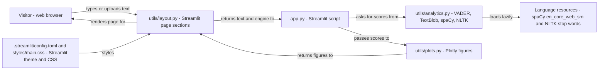

# Text sentiment analyser - Architecture and design rationale

*Last updated: 2026-11-07 · commit 8a9bd36d4*

## 1. Purpose and scope

A Streamlit page that takes pasted text or a small `.txt` upload and shows how positive or negative it reads. It scores
the whole text with two dictionary-based methods (VADER and TextBlob) side by side, scores every sentence to show how
the tone moves, explains which words drive the VADER score, and adds keywords, named entities and basic text statistics.
It is a learning and portfolio project about applied natural language processing with off-the-shelf tools.

It is not a trained or benchmarked sentiment model. Both methods look words up in a lexicon, so they miss sarcasm,
context and non-English text, as the README says. Setup and usage are in the [README](../README.md).

## 2. How this project was built

This project was built with Claude Code (Anthropic's AI coding assistant) in a complementary role. Elliott Fairhall is
the author and owner: the project is debugged, tested and used by him for learning and development, and the design
decisions below are explained so that they can be understood, questioned and learned from. AI assistance does not
replace that work, and nothing in this repository should be read as an unreviewed, machine-only product. The commit
history records the assistant as a co-author on the commit that rebuilt the page.

## 3. Architecture at a glance

- Nothing is stored: text, scores and figures exist only for the current session.
- Language resources load on first use, not at import.

The analysis is a pure function of the text and the chosen sentence engine. `utils/analytics.py` imports no Streamlit
code, so every scoring function can be tested without a page. `utils/layout.py` is the only module that touches widgets
and session state, and `utils/plots.py` builds Plotly figures from plain dictionaries and lists.

## 4. Components

| Component   | Responsibility                                                          | Key files                                   | Depends on                            |
| ----------- | ----------------------------------------------------------------------- | ------------------------------------------- | ------------------------------------- |
| Entry point | Page order, minimum-length gate                                         | `app.py`                                    | `utils/layout.py`                     |
| Analytics   | Two sentiment engines, sentence scoring, keywords, entities, statistics | `utils/analytics.py`                        | vaderSentiment, TextBlob, spaCy, NLTK |
| Plots       | Engine comparison, sentence timeline, word valence, keyword bars        | `utils/plots.py`                            | Plotly                                |
| Layout      | Input box, examples, upload, verdict, tinted text, detail tabs          | `utils/layout.py`                           | Streamlit, analytics, plots           |
| Theme       | Colours, fonts, light and dark modes, text highlight styles             | `.streamlit/config.toml`, `styles/main.css` | Streamlit                             |
| Tests       | Engines, parsing helpers, figures, live page, dependency pins           | `tests/`                                    | pytest, `AppTest`                     |

`utils/text.py` is a leftover from an earlier version of the app. Nothing imports it, and its wording (for example
"Process Intelligence" and gradient text) no longer matches the page. See section 8.

Behaviour that is not obvious from the names:

- Both engines use one neutral band: a score within 0.05 of zero is "Neutral". VADER's own convention is 0.05, and
  TextBlob is held to it so that the two labels can be compared and a disagreement is meaningful.
- `sentiment_words()` looks each word up in VADER's lexicon without applying negation or intensifiers. Its docstring
  calls it a reading aid, not the score itself.
- `highlight_html()` colours each sentence by polarity and escapes all user text before it enters markup.

## 5. Data and control flow

1. `app.py` sets up the page and builds the sidebar, which returns the engine for sentence scores (VADER or TextBlob).
2. `render_input()` shows an example picker, a text area and a `.txt` uploader. Examples and uploads write into the text
   area through callbacks and `st.session_state`. Anything beyond 20,000 characters is cut and a warning is shown.
3. If the trimmed text has fewer than five characters, the page shows a prompt and stops.
4. Otherwise `render_verdict()` runs both engines and shows the two labels, the TextBlob subjectivity and a note if they
   disagree. `render_timeline()` scores each sentence and draws the bars and the tinted text. `render_details()` fills
   four tabs: why this score, keywords, entities and text statistics.
5. The spaCy pipeline and the NLTK stop words load on first use and are held by `lru_cache`, so importing the module
   never touches the network.

State: the text, selected example and uploaded file live in Streamlit session state; nothing is stored. Nothing about
the analysis is cached, so each widget change reruns every step. On failure: empty or whitespace input returns neutral
or empty results from each function; a missing spaCy model triggers a download fallback in `get_nlp()` and raises
`OSError` if that fails (the page does not catch it).

## 6. Design rationale

### Streamlit with live analysis and no submit button

- **Why:** the whole interface is one text box and a set of read-outs. Python-only Streamlit avoids a front-end build
  and one person maintains it. Re-analysing on every change makes it quick to try an example and see the effect.
- **Gave up:** each keystroke commit reruns the whole script, which matters more for long text; there is no explicit
  "analyse" step.
- **Alternative not taken:** a form with a button (the earlier version used one), or a Flask service with a JavaScript
  UI.
- **Evidence:** commit `a4b925caf` ("the analysis now runs live as text changes (no form button)", `documented`).

### Two lexicon methods, VADER and TextBlob, shown side by side

- **Why:** the two give different information. VADER is tuned for short, informal text and gives a compound score;
  TextBlob adds a subjectivity estimate. Showing both, with a note when they disagree, teaches that "the" sentiment of a
  text is method-dependent. Both install as small pure-Python packages and run in milliseconds on a free hosting tier.
- **Gave up:** accuracy on sarcasm, negation across sentences, domain language and anything non-English. Neither method
  is a learned model, and no evaluation against labelled data is included.
- **Alternative not taken:** a transformer sentiment model, which handles context better but needs a large download and
  a model runtime, and would make the project about model serving rather than the comparison.
- **Evidence:** the README states both methods and the limitation (`documented`); the transformer trade-off is
  `inferred`.

### spaCy for sentence splitting and named entities, loaded lazily

- **Why:** sentence-level scoring needs reliable splitting (abbreviations, decimals) and the entities tab needs a
  tagger; one small English pipeline gives both. The model wheel is a declared dependency and loads on first use through
  `lru_cache`, so import stays fast.
- **Gave up:** a larger install, and a `requirements.txt` line that pins the model wheel's release address to spaCy 3.8,
  so a spaCy major upgrade needs that line changed too.
- **Alternative not taken:** regular-expression sentence splitting and no entities, which is lighter but wrong on common
  text; NLTK's tokenisers, which need a separate runtime data download.
- **Evidence:** commit `a4b925caf` records that the model used to be downloaded with pip at import time and failed in
  many environments, and that it is now a declared dependency loaded lazily and cached (`documented`).

### Keywords by simple word counts with stop-word removal

- **Why:** a frequency list is easy to explain and to check by eye. The chart is shown only when a word repeats;
  otherwise the page lists the words as chips, because ranking a list where every count is 1 says nothing.
- **Gave up:** weighting by rarity (TF-IDF), multi-word phrases and stemming. Stop words come from NLTK and are fetched
  on first use if absent, which needs the network once.
- **Alternative not taken:** TF-IDF or RAKE, which need a corpus or more code for little gain on one short text.
- **Evidence:** the `analytics.py` module docstring ("simple word counts") and commit `a4b925caf` (`documented`).

### Explain the score with a lexicon view, not a model explanation

- **Why:** a "Why this score" chart that lists the lexicon words in the text, with their valence, is the cheapest honest
  explanation of a dictionary method, and it is labelled as a reading aid.
- **Gave up:** it does not reproduce VADER's final score because negation and intensifiers are not applied.
- **Alternative not taken:** a model-agnostic explainer such as LIME, which suits learned models, not a lexicon.
- **Evidence:** the `sentiment_words()` docstring (`documented`).

### Pure analytics module, separate from plots and layout

- **Why:** keeping `utils/analytics.py` free of Streamlit means the 26 analytics tests need no page and the same
  functions could serve a command line or notebook. Plot functions take plain data, so they are tested on their own.
- **Gave up:** a few more files and some pass-through of values between modules.
- **Alternative not taken:** one `app.py`, which the earlier version was (commit `a4b925caf` cut `app.py` to 40 lines
  and added `utils/layout.py`).
- **Evidence:** the diff of commit `a4b925caf` and the module docstrings (`documented`); the testing rationale is
  `inferred`.

### Input limits and escaping because of `unsafe_allow_html`

- **Why:** the page injects HTML for the tinted text and entity chips, and the user supplies the text. Every user string
  is passed through `html.escape` first, and a test checks that a script tag appears as text. A 20,000-character cap and
  a 1 MB upload limit (`maxUploadSize = 1` in the config) keep the work bounded on a free hosting tier.
- **Gave up:** long documents are truncated, with a warning; unusual encodings are decoded with replacement characters.
- **Alternative not taken:** native Streamlit text elements only, which cannot tint a sentence.
- **Evidence:** commit `a4b925caf` and `tests/test_sentiment_app.py` (`documented`).

### Native theme with a small stylesheet; dependency floors without caps

- **Why:** the same reasons as the sibling projects. The theme lives in `.streamlit/config.toml`, the stylesheet covers
  only what the theme cannot, floors are set to tested versions, and `test_pillow_security_sentiment.py` stops a Pillow
  cap or Python 3.10 returning.
- **Gave up:** bespoke styling, and protection from breaking upgrades beyond the headless tests.
- **Alternative not taken:** a pinned lock file.
- **Evidence:** commits `a4b925caf`, `f3b4a2b89`, `1d92103f9` (`documented`).

### Hosting on Streamlit Community Cloud

- **Why:** deploys from the repository with no server to run.
- **Gave up:** runtime control; no deployment file is in the repository.
- **Alternative not taken:** a container or managed app service.
- **Evidence:** the README badge links a `streamlit.app` address (`documented`); the rest is `TODO: verify`.

## 7. Quality and testing

Counts are from reading the files; the suite was not run for this document. The commit message for `a4b925caf` reports
68 tests passing on Python 3.11 and 3.13, which agrees with the 61 test functions below plus the parametrised Pillow
checks.

- `tests/test_analytics.py` (26 functions): TextBlob and VADER on positive, negative, neutral, empty and whitespace
  input; word frequency (counts, stop words, limits, case); entities (person, organisation, location, structure).
- `tests/test_plots.py` (10): figure shape, placeholders for empty input, colours by sign, axis range, hover shortening.
- `tests/test_sentiment_app.py` (20): caching of models, sentence splitting and scoring, engine disagreement, lexicon
  words, statistics, HTML escaping, and live page behaviour (empty prompt, examples fill the box, short text, hostile
  markup, over-limit warning, switching engine).
- `tests/test_app_smoke_sentiment.py` (5) and `tests/test_pillow_security_sentiment.py` (5 functions, parametrised):
  page renders, no emoji, restrained stylesheet, theme sections, Pillow and Python floors.

Not tested: the file-upload path (`_load_upload`), non-English or very long real text, performance, the spaCy download
fallback, and `utils/text.py`. The tests depend on the spaCy model being installed. No test checks agreement with
labelled data, so accuracy is unmeasured.

## 8. Constraints, limitations and known gaps

- Dictionary methods only: no sarcasm, no context, English only.
- `SentimentIntensityAnalyzer()` is constructed inside `analyze_sentiment_vader()` and `sentiment_words()`, and
  `score_sentences()` calls the former once per sentence, so VADER's lexicon is rebuilt many times per rerun. The Stock
  project caches its analyser; this one does not. Not measured.
- spaCy runs separately for sentence splitting (twice) and entities on every rerun; no result is cached. Not measured.
- `utils/text.py` is dead code with outdated copy; `pyproject.toml` still names the package `sentiment-dynamics` and the
  description mentions an older scope.
- The upload size limit is configuration only; it is not exercised by a test.
- The hosted deployment's settings are not in the repository (`TODO: verify`).

## 9. Running and extending

See the [README](../README.md) for setup, running and testing. To add an engine, add a result function in
`utils/analytics.py`, include it in `compare_engines()` and `score_sentences()`, extend the sidebar choices in
`utils/layout.py`, and add tests; keep user text escaped whenever it reaches `unsafe_allow_html`. If you add network
access, put it behind a loader like `get_nlp()` so import stays offline.

## 10. Rationale (confirmed by the owner)

Confirmed by Elliott Fairhall on 2026-11-07. This reasoning was first reconstructed from the code and commit history;
the owner has since agreed it is correct, so it is now the stated rationale rather than an inference.

- VADER and TextBlob were chosen because they are small, quick to run on a free tier and different enough to compare,
  with no transformer considered.
- The shared 0.05 neutral band was chosen mainly to make the two labels comparable, not because 0.05 is right for
  TextBlob.
- Uncached per-rerun analysis was acceptable at this scale; performance on long text was not a design goal.
- `utils/text.py` was left behind by the rebuild rather than kept for a reason.
- The 20,000-character and 1 MB limits were set from hosting constraints, not from measured processing time.
